# 基于微信小程序的电影交流平台--论文

> 🎓 **计算机毕业设计 · 基于微信小程序的电影交流平台--论文**
>
> 本仓库只放**项目介绍 + 运行截图**（截图是站点带水印的原图，存在仓库 `images/` 里）。
>
> 👉 **完整可运行源码 / 数据库脚本 / 部署文档：[点我获取](https://geekcode.top/archives/%E5%9F%BA%E4%BA%8E%E5%BE%AE%E4%BF%A1%E5%B0%8F%E7%A8%8B%E5%BA%8F%E7%9A%84%E7%94%B5%E5%BD%B1%E4%BA%A4%E6%B5%81%E5%B9%B3%E5%8F%B0-%E8%AE%BA%E6%96%87?utm_source=github)**
>
> 💬 咨询微信：**ir9372**　|　🌐 更多项目：[极客代码 geekcode.top](https://geekcode.top/?utm_source=github)
>
> 📌 项目详情页：<https://geekcode.top/archives/%E5%9F%BA%E4%BA%8E%E5%BE%AE%E4%BF%A1%E5%B0%8F%E7%A8%8B%E5%BA%8F%E7%9A%84%E7%94%B5%E5%BD%B1%E4%BA%A4%E6%B5%81%E5%B9%B3%E5%8F%B0-%E8%AE%BA%E6%96%87?utm_source=github>

<table><td width="230" align="center"> <b>扫码加微信 ir9372</b></td><td valign="middle">📦 源码 = 项目介绍 + 全部运行截图 + 数据库 + 部署文档 👉 点上方任意截图，直接跳到 <b>极客代码 geekcode.top</b> 详情页</td></table>

---

<h1>基于微信小程序的电影交流平台--论文</h1>
<h2>项目概述</h2>

本项目为“基于微信小程序的电影交流平台”，旨在构建一个集电影资讯展示、用户互动评论及后台管理于一体的综合性服务平台。系统采用前后端分离架构，前端主要依托微信小程序提供移动端服务，后端基于 Java Spring Boot 框架开发，结合 MyBatis-Plus 进行数据持久化操作。核心功能涵盖电影类型管理、电影中心信息维护、用户注册登录、电影评论互动、留言反馈以及我的收藏等模块。该项目适用于电影爱好者获取资讯与交流观点，同时也为管理员提供了高效的内容管理与用户运营工具，解决了传统电影信息平台移动端体验不佳及管理分散的问题。

<h2>技术架构</h2>

系统整体采用分层架构设计，确保代码的可维护性与扩展性。

<strong>后端技术栈：</strong>

<ul>
<li><strong>核心框架</strong>：使用 Spring Boot 作为基础框架，集成 spring-core, spring-context, spring-webmvc 等组件，实现依赖注入与 MVC 模式。</li>
<li><strong>数据访问层</strong>：采用 MyBatis-Plus 简化 SQL 编写与 CRUD 操作，配合 Druid 数据库连接池提升并发处理能力。</li>
<li><strong>安全与控制</strong>：通过 Controller 层（如 UserController, DianyingzhongxinController）处理 HTTP 请求，利用 AOP (spring-aop) 进行日志记录或权限拦截。</li>
</ul>

<strong>前端技术栈：</strong>

<ul>
<li><strong>用户端</strong>：基于微信小程序原生开发或 Vue 集成方案，提供轻量级、无需安装的移动应用体验。</li>
<li><strong>管理端</strong>：基于 Web 浏览器访问的后台管理系统，用于管理员对数据进行增删改查。</li>
</ul>

<strong>数据库设计要点：</strong>
数据库主要包含以下核心实体表：

<ol>
<li><strong>用户表 (yonghu)</strong>：存储注册用户基本信息。</li>
<li><strong>电影中心表 (dianyingzhongxin)</strong>：存储电影详情、海报、简介等核心数据。</li>
<li><strong>电影类型表 (dianyingleixing)</strong>：定义电影分类标签。</li>
<li><strong>评论表 (discussdianyingzhongxin)</strong>：关联用户与电影，存储评论内容。</li>
<li><strong>收藏表 (storeup)</strong>：记录用户对电影的收藏行为。</li>
<li><strong>留言反馈表 (messages)</strong>：收集用户建议与问题。</li>
<li><strong>资讯表 (news)</strong>：发布电影相关新闻动态。</li>
<li><strong>配置表 (config)</strong>：存储系统全局参数。</li>
</ol>

<a href="https://geekcode.top/archives/%E5%9F%BA%E4%BA%8E%E5%BE%AE%E4%BF%A1%E5%B0%8F%E7%A8%8B%E5%BA%8F%E7%9A%84%E7%94%B5%E5%BD%B1%E4%BA%A4%E6%B5%81%E5%B9%B3%E5%8F%B0-%E8%AE%BA%E6%96%87?utm_source=github" title="查看完整源码">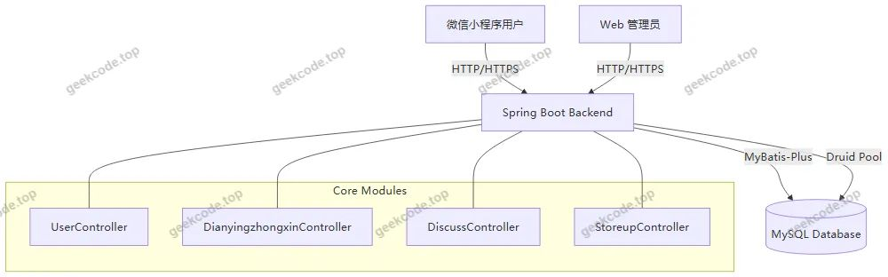</a>

<h2>功能模块</h2>

根据路由配置与截图功能列表，系统分为前台用户端（小程序）和后台管理端两部分。

<h3>1. 前台用户端（微信小程序）</h3>
<ul>
<li><strong>首页</strong>：展示电影推荐、最新资讯入口及导航菜单。</li>
<li><strong>用户认证</strong>：支持微信一键登录、手机号注册、忘记密码重置流程。</li>
<li><strong>电影中心</strong>：浏览电影列表，查看电影详情（包括简介、评分、类型），支持按类型筛选。</li>
<li><strong>互动交流</strong>：在电影详情页发表评论，参与讨论；查看其他用户的评论。</li>
<li><strong>个人中心</strong>：</li>
<li><strong>个人信息</strong>：修改头像、昵称、联系方式等资料。</li>
<li><strong>我的收藏</strong>：查看已收藏的电影列表，支持取消收藏。</li>
<li><strong>留言反馈</strong>：向平台提交意见建议或咨询问题。</li>
<li><strong>资讯浏览</strong>：查看电影相关的新闻公告列表。</li>
</ul>
<h3>2. 后台管理端（Web）</h3>
<ul>
<li><strong>系统登录</strong>：管理员身份验证入口。</li>
<li><strong>首页仪表盘</strong>：展示系统概况或快捷入口。</li>
<li><strong>电影中心管理 (<code>/dianyingzhongxin</code>)</strong>：</li>
<li>新增、编辑、删除电影信息。</li>
<li>上传电影海报、视频链接等资源。</li>
<li>设置电影所属类型、上映时间、导演演员等元数据。</li>
<li><strong>电影类型管理 (<code>/dianyingleixing</code>)</strong>：维护电影分类字典（如动作、喜剧、科幻等），支持增删改查。</li>
<li><strong>评论管理 (<code>/discussdianyingzhongxin</code>)</strong>：审核用户发表的评论，支持删除违规内容。</li>
<li><strong>用户管理 (<code>/yonghu</code>)</strong>：查看注册用户列表，重置密码，禁用异常账号。</li>
<li><strong>留言反馈管理 (<code>/messages</code>)</strong>：查看并回复用户提交的留言反馈。</li>
<li><strong>收藏管理 (<code>/storeup</code>)</strong>：监控用户收藏数据，分析热门电影。</li>
<li><strong>资讯管理 (<code>/news</code>)</strong>：发布、编辑、删除电影资讯文章。</li>
<li><strong>系统配置 (<code>/config</code>)</strong>：修改轮播图、网站名称、版权信息等全局参数。</li>
</ul>
<h2>用户角色与权限</h2>

系统主要涉及两种角色：<strong>普通用户</strong>和<strong>管理员</strong>。

<table>
<thead>
<tr>
<th align="left">角色</th>
<th align="left">可访问功能模块</th>
<th align="left">权限描述</th>
</tr>
</thead>
<tbody><tr>
<td align="left"><strong>普通用户</strong></td>
<td align="left">1. 注册/登录2. 浏览电影中心3. 查看详情与评论4. 发表评论5. 收藏/取消收藏6. 留言反馈7. 个人信息管理8. 查看我的列表</td>
<td align="left">仅能操作自身相关数据（如自己的评论、收藏、信息）。无法进入后台管理界面，无法修改电影源数据或管理其他用户。</td>
</tr>
<tr>
<td align="left"><strong>管理员</strong></td>
<td align="left">1. 电影中心全量CRUD2. 电影类型全量CRUD3. 用户信息管理4. 评论审核与管理5. 留言反馈处理6. 资讯发布与管理7. 系统配置修改8. 收藏数据统计</td>
<td align="left">拥有最高权限，可对系统中所有数据进行增加、删除、修改和查询操作。负责内容审核、用户管理及系统维护。</td>
</tr>
</tbody></table>

<em>注：根据现有路由 <code>/yonghu</code> 和截图“小程序-管理端-用户列表”，部分管理功能可能也开放给特定高级用户或通过小程序内嵌的管理入口访问，但核心数据维护权限主要集中在 Web 后台。</em>

<h2>项目特色与创新点</h2>
<ol>
<li><strong>多端协同体验</strong>：创新性地将电影社区的核心交互场景迁移至微信小程序，利用其“即用即走”的特性降低用户使用门槛，同时保留 Web 后台强大的数据管理能力，形成“C端轻量化 + B端专业化”的最佳实践。</li>
<li><strong>闭环互动机制</strong>：构建了“观看-评论-收藏-反馈”的用户行为闭环。通过 <code>storeup</code>（收藏）和 <code>discussdianyingzhongxin</code>（评论）模块，不仅增强了用户粘性，还为管理员提供了精准的数据支撑以优化内容推荐。</li>
<li><strong>模块化数据治理</strong>：基于 MyBatis-Plus 实现了高度自动化的数据持久层，将电影类型 (<code>dianyingleixing</code>) 独立为字典表，实现了内容与分类解耦，便于后续扩展新的电影类别而无需修改核心逻辑。</li>
<li><strong>完善的运维支持</strong>：内置 <code>config</code>（系统配置）和 <code>messages</code>（留言反馈）模块，使得平台具备自我迭代能力，管理员可根据用户反馈实时调整前端展示策略（如轮播图、公告），提升了系统的响应速度和服务质量。</li>
</ol>
<h2>部署环境</h2>

为确保项目正常运行，需准备以下软硬件环境：

<strong>硬件要求：</strong>

<ul>
<li>CPU: Intel Core i5 及以上</li>
<li>内存: 8GB RAM 及以上</li>
<li>硬盘: 500GB 可用空间</li>
</ul>

<strong>软件环境：</strong>

<ol>
<li><strong>JDK</strong>: Java Development Kit 1.8 (推荐版本) 或 JDK 11。</li>
<li><strong>Maven</strong>: Apache Maven 3.6+，用于项目依赖管理和构建。</li>
<li><strong>数据库</strong>: MySQL 5.7 或 MySQL 8.0，字符集建议设置为 utf8mb4 以支持特殊表情符号。</li>
<li><strong>服务器</strong>: Tomcat 8.5+ (Spring Boot 内置 Tomcat，通常无需单独安装外部 Tomcat)。</li>
<li><strong>前端开发工具</strong>:</li>
</ol>
<ul>
<li><strong>微信开发者工具</strong>: 用于编译、调试和预览微信小程序代码。</li>
<li><strong>Node.js &amp; npm</strong>: 若前端采用 Vue 集成方案，需安装 Node.js (LTS 版本) 及相关包管理器。</li>
</ul>
<ol start="6">
<li><strong>IDE</strong>: IntelliJ IDEA 或 Eclipse，用于后端代码开发与调试。</li>
</ol>

<strong>部署步骤简述：</strong>

<ol>
<li>导入 MySQL 数据库脚本，创建 <code>movie_platform</code> 库。</li>
<li>修改后端配置文件 (<code>application.yml</code> 或 <code>properties</code>) 中的数据库连接地址、用户名和密码。</li>
<li>使用 Maven 打包后端项目生成 jar 包，并通过命令行启动。</li>
<li>在微信开发者工具中导入小程序源码，配置 AppID 和后端接口域名（本地调试需关闭域名校验或使用代理）。</li>
</ol>
<h2>五、技术特性</h2>
<ul>
<li>前后端集成部署，前端资源打包至后端 static 目录</li>
<li>使用 MyBatis-Plus 简化数据访问层开发</li>
</ul>
<h2>六、功能模块截图</h2>
<h3>前台用户端</h3>
<h4>前台首页框架</h4>

<a href="https://geekcode.top/archives/%E5%9F%BA%E4%BA%8E%E5%BE%AE%E4%BF%A1%E5%B0%8F%E7%A8%8B%E5%BA%8F%E7%9A%84%E7%94%B5%E5%BD%B1%E4%BA%A4%E6%B5%81%E5%B9%B3%E5%8F%B0-%E8%AE%BA%E6%96%87?utm_source=github" title="查看完整源码">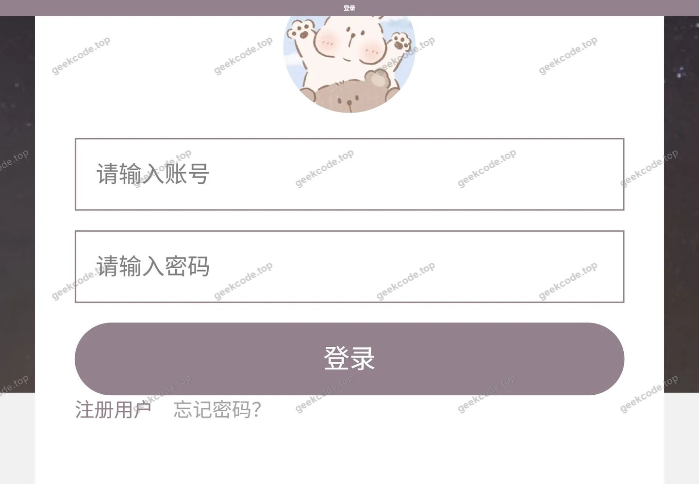</a>

<h3>微信小程序用户端</h3>

<figure><a href="https://geekcode.top/archives/%E5%9F%BA%E4%BA%8E%E5%BE%AE%E4%BF%A1%E5%B0%8F%E7%A8%8B%E5%BA%8F%E7%9A%84%E7%94%B5%E5%BD%B1%E4%BA%A4%E6%B5%81%E5%B9%B3%E5%8F%B0-%E8%AE%BA%E6%96%87?utm_source=github" title="查看完整源码">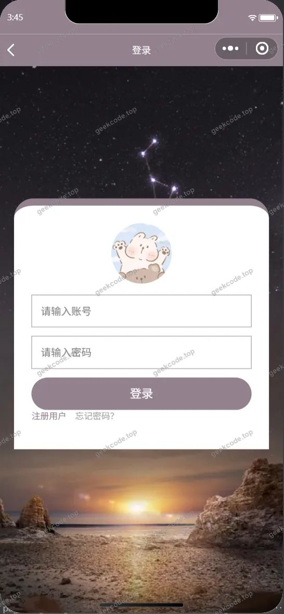</a><figcaption>小程序-登录</figcaption></figure>
<figure><figcaption>小程序-电影中心</figcaption></figure>
<figure><figcaption>小程序-电影中心详情</figcaption></figure>
<figure><figcaption>小程序-个人信息</figcaption></figure>
<figure><figcaption>小程序-留言反馈</figcaption></figure>
<figure><a href="https://geekcode.top/archives/%E5%9F%BA%E4%BA%8E%E5%BE%AE%E4%BF%A1%E5%B0%8F%E7%A8%8B%E5%BA%8F%E7%9A%84%E7%94%B5%E5%BD%B1%E4%BA%A4%E6%B5%81%E5%B9%B3%E5%8F%B0-%E8%AE%BA%E6%96%87?utm_source=github" title="查看完整源码">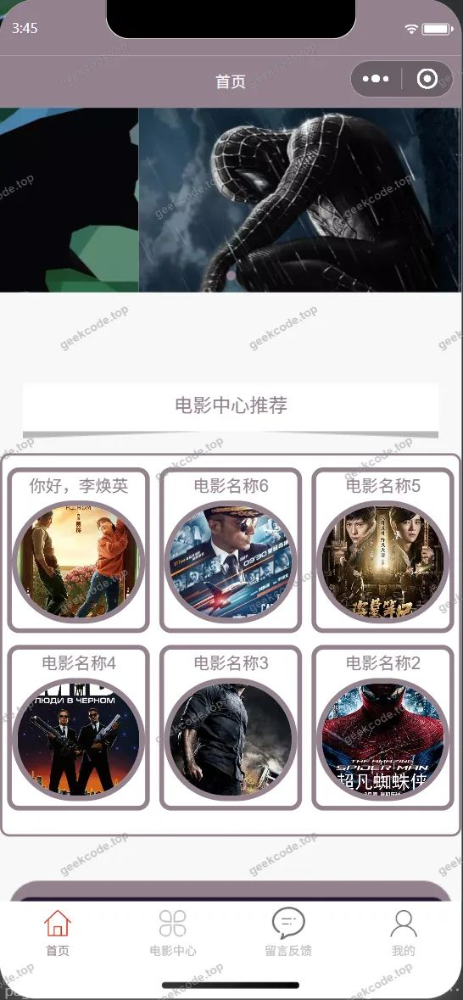</a><figcaption>小程序-首页</figcaption></figure>
<figure><figcaption>小程序-忘记密码</figcaption></figure>
<figure><figcaption>小程序-我的</figcaption></figure>
<figure><figcaption>小程序-我的收藏列表</figcaption></figure>
<figure><a href="https://geekcode.top/archives/%E5%9F%BA%E4%BA%8E%E5%BE%AE%E4%BF%A1%E5%B0%8F%E7%A8%8B%E5%BA%8F%E7%9A%84%E7%94%B5%E5%BD%B1%E4%BA%A4%E6%B5%81%E5%B9%B3%E5%8F%B0-%E8%AE%BA%E6%96%87?utm_source=github" title="查看完整源码">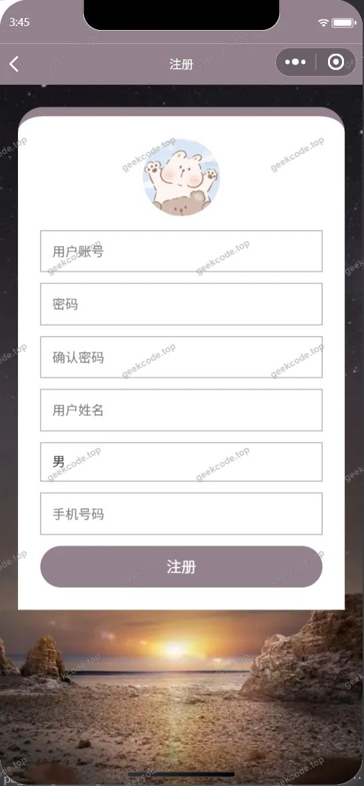</a><figcaption>小程序-注册</figcaption></figure>

<h3>微信小程序管理端</h3>

<figure><figcaption>小程序-管理端-电影类型列表</figcaption></figure>
<figure><a href="https://geekcode.top/archives/%E5%9F%BA%E4%BA%8E%E5%BE%AE%E4%BF%A1%E5%B0%8F%E7%A8%8B%E5%BA%8F%E7%9A%84%E7%94%B5%E5%BD%B1%E4%BA%A4%E6%B5%81%E5%B9%B3%E5%8F%B0-%E8%AE%BA%E6%96%87?utm_source=github" title="查看完整源码">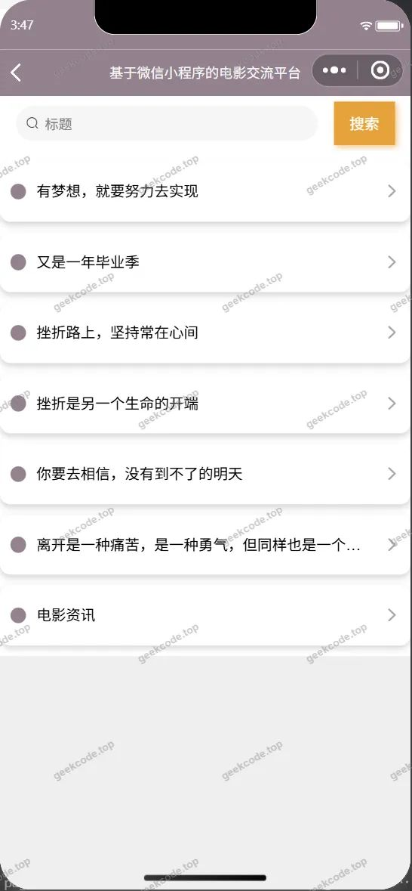</a><figcaption>小程序-管理端-电影资讯列表</figcaption></figure>
<figure><figcaption>小程序-管理端-用户列表</figcaption></figure>
<figure><figcaption>小程序-管理端-用户详情</figcaption></figure>

<h3>后台管理端</h3>
<h4>后台-登录页</h4>

<h4>后台-电影类型</h4>

<a href="https://geekcode.top/archives/%E5%9F%BA%E4%BA%8E%E5%BE%AE%E4%BF%A1%E5%B0%8F%E7%A8%8B%E5%BA%8F%E7%9A%84%E7%94%B5%E5%BD%B1%E4%BA%A4%E6%B5%81%E5%B9%B3%E5%8F%B0-%E8%AE%BA%E6%96%87?utm_source=github" title="查看完整源码">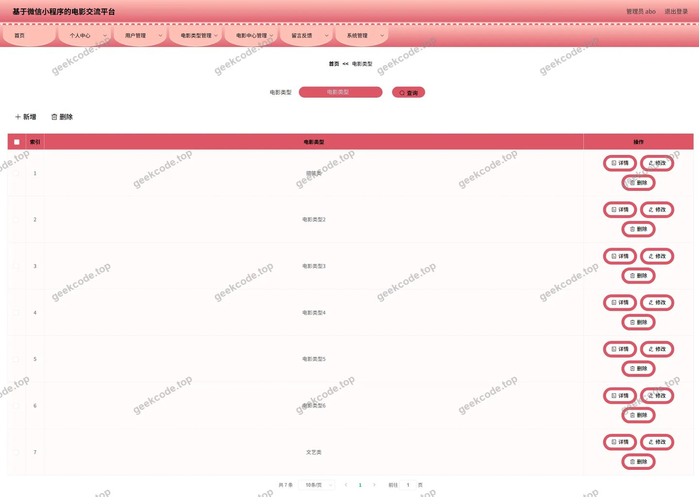</a>

<h4>后台-电影中心</h4>

<a href="https://geekcode.top/archives/%E5%9F%BA%E4%BA%8E%E5%BE%AE%E4%BF%A1%E5%B0%8F%E7%A8%8B%E5%BA%8F%E7%9A%84%E7%94%B5%E5%BD%B1%E4%BA%A4%E6%B5%81%E5%B9%B3%E5%8F%B0-%E8%AE%BA%E6%96%87?utm_source=github" title="查看完整源码">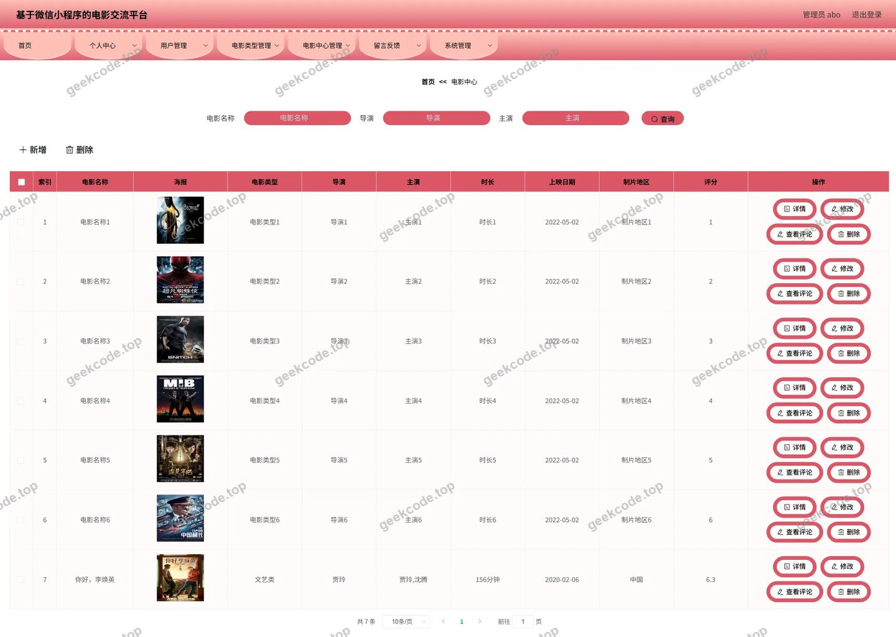</a>

<h4>后台-电影中心评论</h4>

<a href="https://geekcode.top/archives/%E5%9F%BA%E4%BA%8E%E5%BE%AE%E4%BF%A1%E5%B0%8F%E7%A8%8B%E5%BA%8F%E7%9A%84%E7%94%B5%E5%BD%B1%E4%BA%A4%E6%B5%81%E5%B9%B3%E5%8F%B0-%E8%AE%BA%E6%96%87?utm_source=github" title="查看完整源码">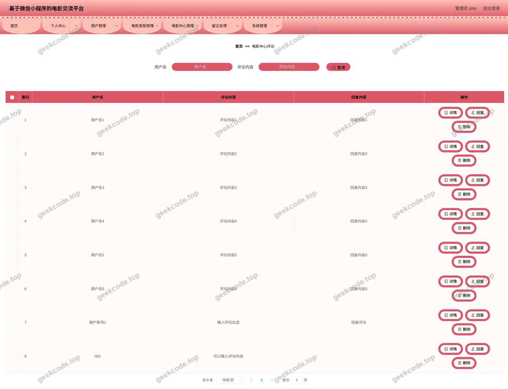</a>

<h4>后台-电影资讯</h4>

<a href="https://geekcode.top/archives/%E5%9F%BA%E4%BA%8E%E5%BE%AE%E4%BF%A1%E5%B0%8F%E7%A8%8B%E5%BA%8F%E7%9A%84%E7%94%B5%E5%BD%B1%E4%BA%A4%E6%B5%81%E5%B9%B3%E5%8F%B0-%E8%AE%BA%E6%96%87?utm_source=github" title="查看完整源码">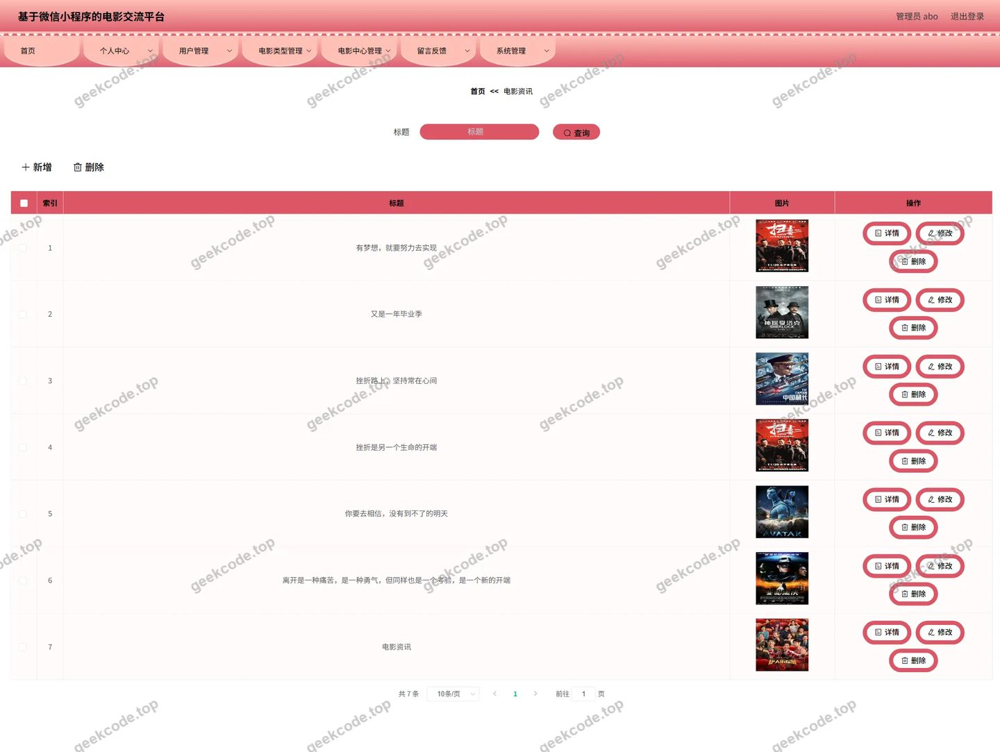</a>

<h4>后台-留言反馈</h4>

<a href="https://geekcode.top/archives/%E5%9F%BA%E4%BA%8E%E5%BE%AE%E4%BF%A1%E5%B0%8F%E7%A8%8B%E5%BA%8F%E7%9A%84%E7%94%B5%E5%BD%B1%E4%BA%A4%E6%B5%81%E5%B9%B3%E5%8F%B0-%E8%AE%BA%E6%96%87?utm_source=github" title="查看完整源码">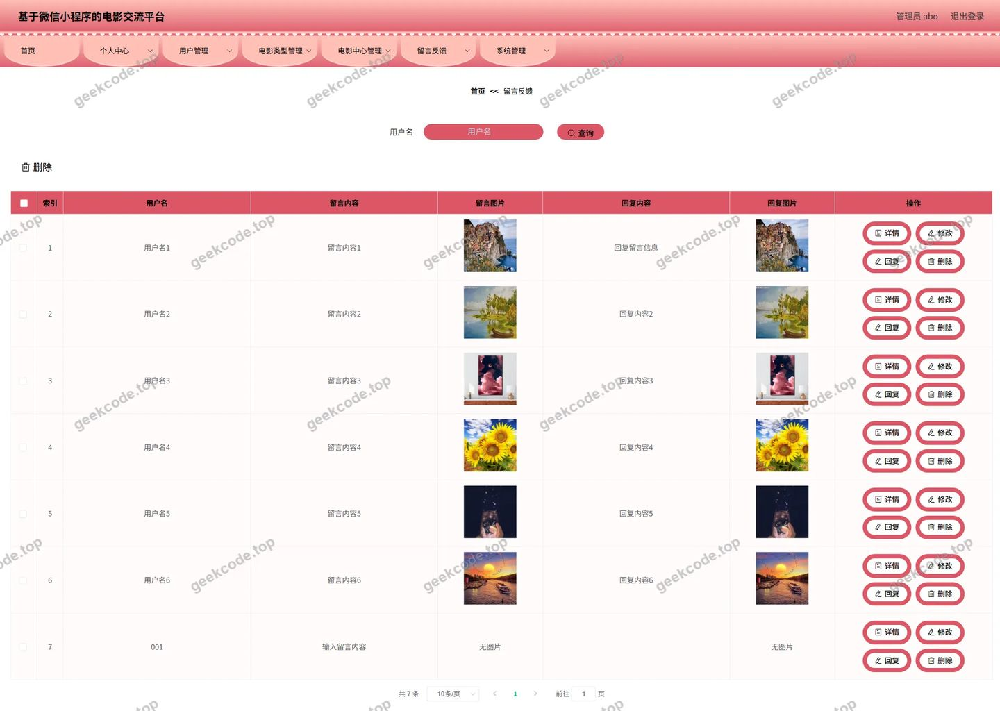</a>

<h4>后台首页</h4>

<h4>后台-用户</h4>

<a href="https://geekcode.top/archives/%E5%9F%BA%E4%BA%8E%E5%BE%AE%E4%BF%A1%E5%B0%8F%E7%A8%8B%E5%BA%8F%E7%9A%84%E7%94%B5%E5%BD%B1%E4%BA%A4%E6%B5%81%E5%B9%B3%E5%8F%B0-%E8%AE%BA%E6%96%87?utm_source=github" title="查看完整源码">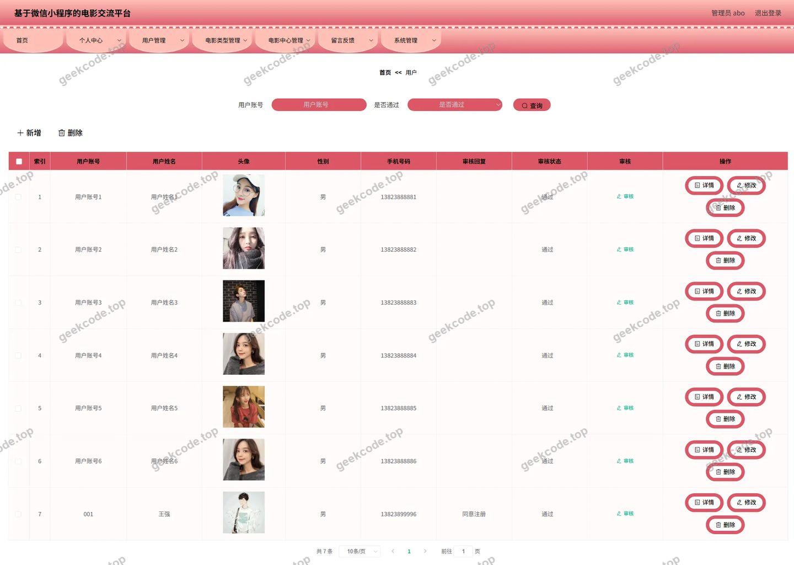</a>

---

## 获取完整源码

| 项目 | 说明 |
| --- | --- |
| 项目名 | 基于微信小程序的电影交流平台--论文 |
| 运行截图 | 本文 24 张（站点带水印原图，仓库 `images/` 目录） |
| 完整源码 | [https://geekcode.top/archives/%E5%9F%BA%E4%BA%8E%E5%BE%AE%E4%BF%A1%E5%B0%8F%E7%A8%8B%E5%BA%8F%E7%9A%84%E7%94%B5%E5%BD%B1%E4%BA%A4%E6%B5%81%E5%B9%B3%E5%8F%B0-%E8%AE%BA%E6%96%87?utm_source=github](https://geekcode.top/archives/%E5%9F%BA%E4%BA%8E%E5%BE%AE%E4%BF%A1%E5%B0%8F%E7%A8%8B%E5%BA%8F%E7%9A%84%E7%94%B5%E5%BD%B1%E4%BA%A4%E6%B5%81%E5%B9%B3%E5%8F%B0-%E8%AE%BA%E6%96%87?utm_source=github) |
| 咨询微信 | **ir9372**（备注：jingpin-yuanma） |
| 更多项目 | [极客代码 geekcode.top](https://geekcode.top/?utm_source=github) |

> 需要源码、部署、改配置、跑不起来等问题，加微信 ir9372 沟通，说明项目名即可。
